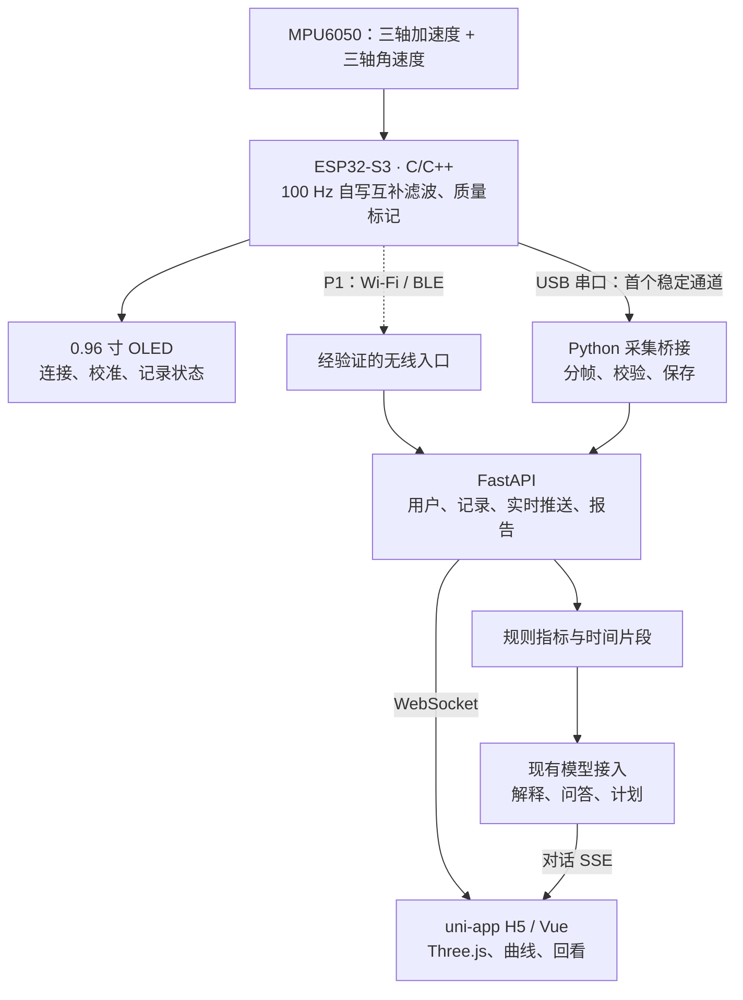

# PowderPilot Move：可穿戴运动记录与 AI 交互技术方案

> 编写日期：2026-11-07（Asia/Shanghai）
>
> 使用场景：约 24 小时黑客松，供硬件、算法、后端、前端协作开发；PowderPilot Move 为暂定原型名称。
>
> 状态：**系统集成设计文档。用户已提供自写滤波方案与试验记录；本次未审阅对应 C 源码或复测硬件，App 新接口与完整链路仍待实现、验收。**
>
> 已确认硬件：**MPU6050 模块 ×1、ESP32-S3 ×1、0.96 寸 OLED ×1，无磁力计。主方案改为自写六轴互补滤波，100 Hz 采样，MPU6050 的 I²C 起点为 100 kHz。**
>
> 文中的协议、拟建模块和验收目标仍属于设计；JSON 和代码块为示例。第 7.10 节单独摘录用户材料中的试验数字，并注明来源，不作为全系统验收结果。

## 阅读导航

- [产品与边界](#1-项目定位与用户体验)：第 1–3 节。
- [硬件、接线、语言与整体架构](#4-硬件清单与接线)：第 4–6 节。
- [姿态融合、固件、协议](#7-姿态融合坐标标定与算法)：第 7–9 节。
- [自写滤波流程](#75-主算法自写六轴互补滤波)、[参数表](#79-自写滤波参数表)、[用户提供的试验记录](#710-用户材料中的试验记录未复测)：算法与测试来源。
- [后端、三维界面、报告与 AI](#10-后端接入与存储)：第 10–13 节。
- [模型扩展](#14-专项动作识别与预训练资源)、[24 小时排期](#15-24-小时排期与分工)、[验收](#16-测试精度与验收)、[演示](#17-展示设计与一分钟演示)：第 14–17 节。
- [待确认事项](#18-开工前待确认清单)与[参考资料](#19-参考资料与复用边界)：第 18–19 节。

## 1. 项目定位与用户体验

### 1.1 要做的产品

一个可穿戴的运动数据采集设备，连接 App，记录运动过程、展示设备姿态、形成可回看的报告，并允许用户围绕本次记录与 AI 对话。

以滑雪作为首个产品场景，后续按真实数据和验证结果扩展篮球等运动。通用采集、记录和交互框架可以复用；不同运动的动作识别、佩戴方式和指标需要分别开发与评估。

核心体验：

```text
戴上设备
→ App 选择运动与佩戴位置
→ 校准并开始记录
→ 实时查看三维设备姿态、角度和数据质量
→ 结束记录，生成报告
→ 点选片段回看
→ 围绕这次记录问 AI
→ 形成下一次记录或练习计划卡
```

核心产品仍然是“运动记录设备 + App + AI 数据交互”。MPU6050 提供六轴采样，ESP32-S3 完成采集和融合，OLED 显示设备状态；摄像头用于标注和对照验证。

### 1.2 用户遇到的问题

原型先验证三个具体需求：

1. 用户知道自己运动过，但难以回忆哪一段发生了明显变化。
2. 原始数字和曲线不容易理解，需要结合时间点解释。
3. 用户希望下一次继续记录、比较，而不必每次重新整理数据。

这些是待用户访谈验证的需求假设。比赛期间邀请实际体验者试用，记录其理解、疑问与再次使用意愿；不要把团队推测写成已验证结论。

### 1.3 与原 PowderPilot 的关系

已有软件主线提供雪场资料、可溯源问答和行程辅助；本方案增加独立的运动记录原型：

| 能力 | 用户问题 | 数据来源 |
|---|---|---|
| 雪场与行程 | 去哪里、怎么安排、有哪些费用 | 策展 YAML、MySQL、知识库证据 |
| 运动记录 | 设备如何运动、哪段变化较大 | 本人的传感器采样与版本化算法 |
| 记录问答 | 这些变化说明什么、依据在哪里 | 已计算的指标、片段和质量信息 |

本方案是独立硬件竞赛扩展，不应把既有雪场能力描述为已经支持个人运动分析。真实雪场资料仍以 YAML 为单一真相源；个人传感器记录使用独立存储和溯源结构。

## 2. 当前状态与实现优先级

### 2.1 当前已核对的仓库基础

| 能力 | 当前依据 | 与原型的关系 |
|---|---|---|
| FastAPI 分层与统一响应 | `main.py`、`schemas/result.py` | 新接口沿用分层及 `code/msg/data` |
| JWT 登录 | `api/user.py`、`config/dependencies.py` | 新记录必须绑定当前用户 |
| 模型供应商配置 | `config/config.py`、`agent/agent.py` | 复用已接通的模型，不重新搭供应商接入 |
| H5 问答与 SSE | `api/chat.py`、`ski-front/api/chat.js` | 复用交互方式，运动数据另走实时通道 |
| 行程卡与字段校验 | `schemas/trip.py`、`agent/card_check.py` | 借鉴结构化输出思路，运动卡单独定义与校验 |

上表路径均相对于 `ski-backend/`。这里核对的是代码结构，没有因此验证当前数据库、模型账号或硬件处于可用状态。

新增算法依据是用户提供的《自写六轴补偿滤波思路.md》，材料描述了 `comp_filter.c / comp_filter.h` 和 ESP32-S3 + MPU6050 的试验。本 README 据此整合算法与接口方案，没有把引用的文件名当作本仓库内已经存在的固件，也没有核验实际编译版本。

### 2.2 本次范围

| 优先级 | 功能 | 完成含义 |
|---|---|---|
| P0 | 一枚 MPU6050 的六轴真实采集 | 固定采样、时间戳、序号、重启识别 |
| P0 | 六轴姿态融合与数据质量 | 输出四元数；yaw 明确标为会漂移的相对转向 |
| P0 | 三维姿态与曲线 | 模型按正确方向旋转，角度变化可回看 |
| P0 | 一次记录的开始、结束、保存 | 文件与元数据完整，断开有留痕 |
| P0 | 规则计算的运动记录报告 | 数字来自采样，结论关联时间片段 |
| P0 | 围绕记录的 AI 问答 | 使用本人记录；缺乏依据时明确说明 |
| P0 | OLED 基础状态 | 显示校准、就绪、记录、断开，不拖慢采样 |
| P1 | 两次记录比较 | 佩戴位置、任务和校准口径可比 |
| P1 | 无线传输 | 根据先期连通测试选择 Wi-Fi 或 BLE |
| P1 | 简单外壳与固定结构 | 设备不松动，便于佩戴和演示 |
| P2 | 语音、专业动作分类、更多运动 | 在核心链路完成后按余量推进 |

### 2.3 第一版能表达的内容

- 记录时长、采样覆盖、丢帧和断开情况。
- 设备角速度、加速度、融合姿态及其变化；重力补偿后的线性加速度另标为依赖姿态与标定的估计值。
- 相对初始姿态的角度变化、变化较大的时间片段；roll / pitch 受重力约束，yaw 仅作短时相对转向展示。
- 在固定任务与佩戴方式下，经验证的节奏或周期统计。

第一版不直接承诺膝关节角度、身体重心、雪板立刃角、滑雪水平、疲劳、伤病风险或投篮命中率。没有真实专项数据时，实验室动作应标“设备测试”，不能包装为已验证的滑雪分析。

## 3. 朝向、姿态与位置的区别

| 概念 | 含义 | 主要技术 |
|---|---|---|
| 姿态 | 设备在三维空间如何旋转 | MPU6050 的加速度、陀螺仪与六轴融合算法 |
| 相对转向 / yaw | 设备相对初始参考的转动分量 | 陀螺仪积分与姿态融合，随时间可能漂移 |
| 绝对航向 | 相对磁北 / 真北的水平朝向 | 当前硬件没有可用的绝对航向参考 |
| 位置 / 轨迹 | 人或设备在哪里、经过哪里 | 室外 GNSS / 手机定位，或室内视觉、UWB 等 |

MPU6050 是三轴加速度计 + 三轴陀螺仪，没有磁力计。六轴指六路测量，不是六个独立转动方向。

在静止或缓慢运动时，加速度测得的重力方向可以帮助约束 roll / pitch；快速运动、冲击和持续线性加速度会影响这项修正。重力无法约束绕竖直方向的转动，所以 yaw 仍会受陀螺仪零偏等影响而漂移。四元数照常能驱动三维模型，只是不能因此宣称获得了无漂移的绝对朝向。

本期保留三维随动、短时相对转向、倾斜与角速度分析，并使用静止在线零偏跟踪减少静止漂移。界面标明“六轴 · 无绝对航向参考”；在线跟踪与回零均不提供北向参考，也不能消除所有后续漂移。加速度连续积分仍不足以提供长期可靠的位置，当前硬件不输出雪场轨迹或滑行路线。

### 3.1 佩戴位置决定解释范围

| 安装位置 | 可以记录 | 需要额外条件的结论 |
|---|---|---|
| 腰部 | 腰部设备的运动、旋转和倾斜 | 膝角、全身姿态、身体重心 |
| 一只雪靴 | 该雪靴的姿态变化 | 双脚关系、雪板相对坡面的角度 |
| 手腕 | 腕部运动信号 | 球的运动轨迹、投篮是否命中 |
| 球拍 | 球拍设备的旋转 | 击球落点、击球质量 |

第一版一枚设备对应一个测量部位。更换佩戴位置需要记录新的安装信息，重新回零；不能沿用之前的动作识别模型或直接比较指标。

## 4. 硬件清单与接线

### 4.1 已确认的硬件

本版依据团队实际持有的三项硬件设计，不再把购买其他 IMU 作为开工条件。

| 物料 | 数量 | 本原型用途 |
|---|---:|---|
| MPU6050 模块 | 1 | 读取三轴加速度和三轴角速度，不含磁场数据 |
| ESP32-S3 开发板 | 1 | C/C++ 驱动、六轴融合、USB / 后续无线通信 |
| 0.96 寸 OLED | 1 | 显示设备连接、校准与记录状态 |

ESP32-S3 的具体开发板版本、GPIO 占用和 USB 通道仍需看实物；不因芯片型号已确认就假定所有开发板引脚相同。0.96 寸只说明尺寸，不能据此确定 OLED 是 I²C 还是 SPI、SSD1306 还是 SH1106，也不能直接确认分辨率。

### 4.2 辅料与开发条件

| 物料 | 数量 | 要求 |
|---|---:|---|
| 面包板、杜邦线 / 焊接连线 | 1 套 | 电源和信号连接稳定，运动时不松脱 |
| 固定带 / 固定袋 | 1 | 固定牢靠，避免模块相对身体晃动 |
| 匹配开发板的 USB 数据线 | 1 | 确认可传数据 |
| 电脑 | 1 | 开发、串口、后端、网页与记录 |
| 电脑或手机摄像头 | 可用即可 | 拍摄对照实验，不作为日常记录的必需入口 |

三项主硬件已有，本轮只核对辅料、固定件和供电成本，不再沿用未核实的整套硬件报价。P0 用 USB 供电和传输；加入无线佩戴后，再确定适配开发板的电池供电方式与续航。

### 4.3 MPU6050 的固定实现路线

主方案为 **MPU6050 原始六轴数据 → 自写补偿 / 互补滤波 → 四元数、欧拉角与线性加速度估计**，滤波模块以用户材料中的 `comp_filter.c / comp_filter.h` 为实现依据。本期不依赖外部姿态库；Fusion 只保留为可选对照工具。MPU6050 的普通原始寄存器不会直接给出这些融合结果，本期也不把配置 DMP 作为前置条件。

建议初始配置，均需写入元数据并实测：

| 配置 | 起步选择 | 原因与核对项 |
|---|---|---|
| 接口 | I²C，100 kHz 起步 | 与用户材料保持一致；共用 OLED 总线需单独验证刷新阻塞 |
| 采样与融合 | 100 Hz | 每 10 ms 一组，使用实测采样时间差 |
| 加速度量程 | ±4 g | 受控演示的初始选择；发生饱和需改量程并记录 |
| 陀螺仪量程 | ±500 °/s | 受控旋转的初始选择，不保证覆盖快速专项动作 |
| 软件低通 | 陀螺每级 30 Hz、加速度每级 10 Hz，各串联两级 | 沿用用户方案；不等于两级组合的最终截止频率 |
| 芯片 DLPF 与输出速率 | 待读取当前驱动配置后登记 | 与软件低通分开记录，评估累计延迟与混叠 |

量程切换后换算系数要同步修改。自写滤波输入采用 g 与 °/s，内部积分转换为 rad/s；不要把寄存器整数直接当成物理单位。量程仍是原型建议值，用户材料没有证明当前驱动已经使用了这两档。

### 4.4 I²C 接线与识别

下表按 **四针 I²C OLED** 举例；先确认实物接口。GPIO8 / GPIO9 是示例选择，必须核对当前开发板没有占用，再写入 `board_config.h`。

| ESP32-S3 | MPU6050 模块 | I²C OLED | 说明 |
|---|---|---|---|
| GND | GND | GND | 共地 |
| 3V3 | VCC | VCC | 两块模块均确认支持此供电后使用 |
| GPIO8（SDA 示例） | SDA | SDA | 共用数据线，I²C 上拉须兼容 3.3V 逻辑 |
| GPIO9（SCL 示例） | SCL | SCL | 共用时钟线 |

- ESP32-S3 GPIO 使用 3.3V 逻辑。按实际模块核对稳压、电源与上拉，不将 5V 上拉直接接到 GPIO。
- MPU6050 的 `AD0` 决定常见总线地址 `0x68` / `0x69`；保持确定电平，按模块接法设置。`WHO_AM_I` 常见返回值为 `0x68`，它不是“当前总线地址一定是 0x68”的证明。
- MPU6050 的 INT 可在后续用于数据就绪；P0 可先定时轮询并检查新数据。模块的辅助总线引脚不作为本次主机 I²C 接口使用。
- OLED 常见地址为 `0x3C` / `0x3D`，以扫描结果为准；地址可响应也不等于显示控制器型号已确认。
- MPU6050 先按用户材料的 100 kHz 总线验证 100 Hz 采样；OLED 独立点亮后再合入。是否提高到 400 kHz 需按实物测试，不把不同速率下的结果混为一次验收。
- 若 OLED 为 SPI 版本，MPU6050 继续走 I²C，OLED 按其 SPI 的时钟、数据、片选等引脚另接；不要套用上表的共享总线接法。
- 串口只由一个采集进程持有；开发板、模块与外部电源按实际接法共地，避免 USB 与外部供电冲突。

### 4.5 OLED 的显示内容与刷新

屏幕优先呈现状态，三维、曲线、报告和对话放在网页。按实物确认分辨率与控制器，再选 SSD1306 / SH1106 等相应驱动；P0 可先用驱动自带 ASCII 字体，避免中文点阵占用联调时间。

```text
READY / REC / LOST
R: +3.2  P: -6.1
Yrel: +8.4 DRIFT
100Hz REC 00:24
```

以上只是显示排版示例。`Yrel` 表示相对参考的 yaw，`DRIFT` 提醒其会漂移；数值与状态必须来自同一采集与记录状态，未记录时不显示假的录制计时。

OLED 先以约 2 Hz 更新，并测量对 100 Hz 采样的影响。共享 I²C 需要统一调度与互斥，不能让两个任务同时访问总线。以常见 128×64 单色屏为例，仅 1024 字节像素数据，在 100 kHz I²C 下连同应答位已约 92 ms，在 400 kHz 下也约 23 ms，另有命令开销；两者都超过 10 ms 的采样间隔。

优先局部 / 分块更新和 IMU 采样调度；若驱动只能阻塞全屏传输，应根据实测降低显示工作量或暂停周期数值刷新，也可评估把 I²C OLED 接到另一组 GPIO 与独立 I²C 控制器。如果实物为 SPI OLED，则按其接口单独接线并验证并发时延。不能只把刷新函数放到另一个任务就宣称采样不受影响。

## 5. 开发语言与系统架构

### 5.1 主方案：ESP32 端计算姿态



ESP32-S3 使用 C/C++：MPU6050 驱动把 g / °/s 输入自写 C 滤波模块，输出四元数和派生指标。用户材料的实现平台为 ESP32-S3，但本仓库尚未接入对应 C 源码。Python 保留 FastAPI、存储与 Agent 能力，并在 USB 方案中承担串口桥接。

### 5.2 调试方案：电脑端计算姿态

```text
ESP32 C/C++：仅采集和发送原始数据
→ Python：重放同一套自写滤波逻辑，或运行明确标记的对照算法
→ 与主方案相同的姿态消息
→ 前端与报告
```

该方案用于快速画图、排查轴方向、比较参数。移植到 Python 时应对齐滤波状态初始化、单位、参数与实际 `dt`；如果换成 Fusion 等对照算法，要单独保存算法 ID，不能称为相同实现。展示电脑辅助原型时，应注明融合计算位置。

当前 MPU6050 的四元数由固件主方案或电脑调试方案计算；两种方案均使用无磁力计输入，不能因为换到 Python 计算就获得绝对航向。

### 5.3 各层职责

| 层 | 语言 | 职责 |
|---|---|---|
| 传感器驱动 | C/C++ | 读取、量程换算、采样状态 |
| 自写滤波 | C；调试时 Python | 标定、两级低通、静止判据、零偏跟踪、姿态与线性加速度估计 |
| 采集桥接 | Python | 串口分帧、序号检查、队列与落盘 |
| 后端 | Python | 鉴权、会话、指标、报告、问答 |
| 前端 | JavaScript / TypeScript、Vue | 三维、曲线、状态与回看 |
| 大模型 | 现有远程模型接口 | 基于已计算结果解释与交互 |

## 6. 传输方式与采样预算

### 6.1 先明确三个频率

| 环节 | 起步设计值 | 说明 |
|---|---:|---|
| 采样与融合 | 100 Hz | 每 10 ms 处理一组，使用实际采样时间差 |
| 前端姿态推送 | 25–50 Hz | 显示可取最新值，原始数据仍完整保存 |
| 页面渲染 | 根据终端能力，目标约 60 FPS | 插值用于显示，不改变保存记录 |

三者不必相等；不能把浏览器帧间隔当成传感器采样间隔。100 Hz 与用户材料一致，不代表快速冲击等任务一定得到充分采样。前端可以降低推送频率，原始数据仍按实际采样完整保存；若改为 50 Hz，必须重新选择低通参数、抗混叠策略并复测，不能直接沿用 30 Hz 的软件低通设置。

### 6.2 USB 首先跑通

- 推荐 NDJSON：每个数据帧为一行紧凑 JSON，以真正的换行结束。
- 调试日志使用独立通道，或带可识别的日志前缀，采集端不把日志当数据。
- UART 桥接优先验证 921600 波特，并按实测链路选值；采用 460800 时需确认完整帧吞吐仍有余量。原生 USB CDC 的吞吐不简单等同于配置的波特率。
- 必须用真实帧长度计算吞吐：8N1 下理论有效字节率约为波特率 / 10，还需留余量。
- 例如 500 字节 × 100 帧/秒约为 50 KB/s，超过 115200 与 460800 波特的理论约 11.5 / 46.1 KB/s；921600 理论约 92.2 KB/s，仍需留余量并实测。诊断字段可另走低频事件，但不能因此丢掉原始采样。
- 串口读取可能遇到半行、多行、无效字节。接收端维护缓冲、最大行长和解析错误计数。

### 6.3 无线属于独立验收项

| 方式 | 适用 | 增加的工作 |
|---|---|---|
| Wi-Fi → 后端 | ESP32 与电脑处于可互通局域网 | 配网、重连、设备绑定、网络隔离排查 |
| BLE → 手机或电脑网关 | 希望低功耗近距离佩戴 | GATT、MTU、分包重组、权限与平台适配 |
| 网页直接连接 BLE | 支持 Web Bluetooth 的浏览器与系统 | 支持范围实测，不能假定所有手机可用 |

当前前端以 H5 验证为主，不代表 Android、iOS、BLE 和后台采集已完成验证。无线设备必须把未上传、断开和缓存溢出显式反映到质量信息中。

## 7. 姿态融合：坐标、标定与算法

### 7.1 固定三套约定

| 项目 | 本方案约定 |
|---|---|
| 设备 / 安装坐标 | 右手系：X 指设备前方，Y 指左侧，Z 指上方 |
| 算法参考 | 固定 Z 向上的右手系，水平参考从初始化建立，不对应磁北 / 真北 |
| 四元数 | Hamilton 约定，`[w,x,y,z]`，表示设备坐标到世界参考坐标的旋转 |
| 欧拉角 | `R = Rz(yaw) × Ry(pitch) × Rx(roll)`，单位度 |
| 前端 | 场景 Z 向上；模型局部轴与设备安装坐标一致 |

设备坐标中的“前方”是安装时约定的轴，不会被芯片自动识别。世界参考坐标与设备安装坐标也不能混为一套轴。

本设备没有磁力计。初始化可将 yaw 设为 0，之后由陀螺仪与补偿后的积分跟踪；这个 0 是算法参考，不是北方。前端不显示指南针方位或磁北 / 真北航向。

### 7.2 加速度与陀螺仪必须对齐

按 MPU6050 模块上的轴标识与驱动说明，把加速度和陀螺仪向量一起映射到统一安装坐标，再做融合。芯片丝印、模块排针和实际佩戴朝向不是同一个概念。

映射包括轴交换与符号，必须保持右手坐标系，不能只看哪个方向“比较像”就单独反转一个前端角度。安装旋转也要写入元数据。

### 7.3 单位与重力

- 自写滤波输入的陀螺仪单位为 °/s，加速度为 g、包含重力；四元数积分之前将角速度转为 rad/s。
- 本期不读取磁场；兼容字段 `mag_uT` 固定为 `null`，`mag_used` 固定为 `false`，不能填写估计的磁场。
- 其他库可能要求 rad/s 或 m/s²，切换库时必须通过适配层转换。
- 融合前不要把重力从加速度中直接减掉；线性加速度是另一个派生输出。
- 输出转换为有限数值和单位四元数，禁止 NaN、Infinity 或近零范数进入前端。

### 7.4 校准步骤

1. 核对 MPU6050 设备 ID、驱动、数据频率与量程。
2. 沿用用户方案，上电后固定静止约 2 秒，按实际有效帧计算三轴陀螺仪均值作为初始零偏 `b0`，100 Hz 下期望约 200 个样本；记录波动，期间移动或缺帧明显则重做。
3. 用静止加速度均值计算本次临时统一比例因子 `s = 1 / norm(mean(a_raw))`，并核对轴映射。该值在记录中固定，不对每个动态样本重新取倒数。
4. 低通状态首帧置为对应输入，按重力方向初始化 roll / pitch，yaw 取约定参考；等待状态就绪后开始记录。不要在设备倾斜放置时无条件用单位四元数当作已对齐地面。
5. 戴好后记录安装位置、朝向与校准编号。
6. 用户设定本次初始姿态，创建独立回零参考。

本硬件没有磁力计，不进行硬铁、软铁或“转八字”磁场标定。陀螺仪零偏校准与“设为初始姿态”是不同操作：回零不会修复传感器偏置、温漂或错误轴映射。加速度静止时应保留约 1 g 的重力响应，不能把静止三轴均值全减掉后再交给融合器。

用户材料给出了约 `[-4.87, -0.44, -1.28] °/s` 的陀螺仪零偏，以及静止加速度模长约 `1.024 g`；这些是特定试验的记录值，应重新估计并保存当前设备参数。单个静止姿态无法区分统一比例误差、各轴偏置与安装误差，所以上述 `s` 是临时归一修正，不能称为完整标定；后续做 ±X / ±Y / ±Z 多位置标定。

在接近水平的简化情况下，若残余竖直轴偏置为 0.1 °/s，60 秒就可能积累约 6° 的转向误差。此数字仅说明积分关系，不是本模块的实测漂移；实际结果按第 16 节测量并登记。

### 7.5 主算法：自写六轴互补滤波

算法来源为用户提供的《自写六轴补偿滤波思路.md》，材料称实现位于 `comp_filter.c / comp_filter.h`。本节把其思路整理成可用于前后端联调的算法约定；平滑对象、初始化细节和字段名尚需与实际 C 源码逐项对齐。

核心是“陀螺仪积分 + 加速度低频倾角修正”，属于非线性互补滤波。采用 Mahony 式重力方向比例反馈，同时单独做静止零偏跟踪；不是训练出来的小模型。Fusion、其他 Mahony 实现和材料中的 `imu6` 可用于对照，不是主方案的必要依赖。

#### 7.5.1 数据流与信号命名

```text
MPU6050 原始六轴，100 Hz，输入 g / °/s
→ 单位换算与安装轴映射，保存未做软件补偿的采样
→ 加速度固定比例修正 a_scaled = s × a_raw
→ 陀螺 / 加速度分别经过两级一阶低通
→ 平滑残差判断静止，条件满足时在线更新陀螺零偏
→ 用加速度方向产生加权倾角反馈
→ 四元数旋转增量更新并归一化
→ 四元数、欧拉角、线性加速度估计、质量与诊断状态
```

`a_raw` 为单位换算和轴映射后的 g 值；`a_scaled` 为固定比例修正后的值；`a_tilt` 为进一步低通后用于倾角反馈的值；`gyro_lpf` 为低通后的 °/s。原始流保留，不能只存滤波后的结果。

固定 `s` 与向量单位化用途不同：`a_scaled` 保留运动幅值；只有计算“方向”时才使用 `a_tilt / norm(a_tilt)`。逐帧把加速度强制归一成 1 g 会丢失运动信息，并破坏动态权重与线性加速度估计。

#### 7.5.2 两级一阶低通

每级采用相同的一阶指数更新，系数根据实际 `dt` 计算：

```text
alpha = 1 - exp(-2 × pi × fc × dt)
y1 = y1 + alpha × (input - y1)
y2 = y2 + alpha × (y1 - y2)
```

陀螺每级 `fc = 30 Hz`，加速度每级 `fc = 10 Hz`。两级状态都在首帧设为输入，避免从 0 爬升产生启动误差。串联可增强平滑并增加相位延迟；它不是二阶 Butterworth，组合的最终截止频率也不等于表中的每级参数。芯片 DLPF 还会叠加延迟，需和软件滤波一起测量。

#### 7.5.3 静止判据与在线零偏跟踪

先有启动零偏 `b0`，再进行静止检测。不能因为原始陀螺偏置大，就用尚未扣偏的值与 `0.6 °/s` 比较而永远无法开始校准。

下面给出明确的联调定义：对残差模长和加速度模长偏差进行约 0.25 秒平滑，再比较阈值；实际源码采用的平滑对象应另行核对并锁定。

```text
r = gyro_lpf - b
r_detect = EMA(norm(r), tau = 0.25 s)
a_detect = EMA(abs(norm(a_scaled) - 1), tau = 0.25 s)

candidate_rest = r_detect < 0.6 °/s AND a_detect < 0.03 g
rest_detected = candidate_rest 连续成立至少 1.0 s
```

先取模长再平滑可避免正负分量相互抵消。饱和、非法采样、重启或明显缺口应退出静止判定并重置持续时间。平滑会延迟状态切换，它不能保证“不误触发”；快速运动开始和接近阈值的慢转都要单独测试。

仅当静止被判定且允许在线补偿时，更新三轴零偏：

```text
beta = 1 - exp(-dt / bias_tau_s)     # 默认 bias_tau_s = 5 s
b = b + beta × (gyro_lpf - b)
gyro_corrected_dps = gyro_lpf - b
```

运动时冻结 `b`，仍使用当前残差积分。该机制旨在减少后续零偏积累，不会把此前已经积累的 yaw 自动恢复为真实朝向。保存 `rest_detected`、`bias_tracking_active` 与 `gyro_bias_dps`，并提供关闭在线跟踪的配置；阈值以下的真实慢转可能被当作偏置吸收。

#### 7.5.4 加权的重力方向反馈

本节采用设备到算法参考系的四元数 `q`，令 `R(q)` 为对应旋转矩阵。静止时加速度计的比力方向接近参考系 +Z：

```text
up_est  = transpose(R(q)) × [0, 0, 1]
up_meas = a_tilt / norm(a_tilt)
err = cross(up_meas, up_est)

deviation_g = abs(norm(a_scaled) - 1)
tilt_weight = clamp((0.15 - deviation_g) / (0.15 - 0.03), 0, 1)
omega_rad_s = gyro_corrected_dps × pi / 180 + kp × tilt_weight × err
```

默认 `kp = 2 s^-1`，小角度、满权重下的倾角反馈时间尺度约 0.5 秒，实际响应还受滤波影响。加速度模长小于 `0.2 g`、数据异常或饱和时，停止这项倾角反馈；方向归一化前检查范数。

这里用低通方向 `a_tilt` 做反馈，以 `a_scaled` 的模长偏差控制权重，是本 README 的信号定义；需与 C 实现统一并保存版本。模长接近 1 g 并不能证明没有线性加速度，所以权重衰减只是启发式处理，不能保证所有动态姿态都正确。

叉乘顺序与四元数方向、乘法顺序成套使用。按本节约定验证单轴小角度扰动应收敛，不单独翻转一个符号来掩盖坐标错误。

#### 7.5.5 四元数旋转增量积分

```text
rate = norm(omega_rad_s)
h = 0.5 × rate × dt
dq = [cos(h), sin(h) / rate × omega_rad_s]
q_next = normalize(q ⊗ dq)
```

`rate` 接近 0 时采用稳定极限 `dq ≈ [1, 0.5 × dt × omega_rad_s]`，再归一化。该指数旋转更新对单个间隔内角速度恒定的假设是精确的，比简单一阶四元数更新更好地处理有限旋转步长。

它不等于恢复了丢失采样：若间隔从 10 ms 增到 30 ms，其间真实角速度变化仍未知。使用实际 `dt` 并记录缺口，不能因此声明“大 dt 没有额外误差”；过长间隔按明确策略中断或重新初始化。

### 7.6 时间与异常

使用 ESP32 的单调采样时钟，建议 64 位微秒时间。`esp_timer_get_time()` 是可选实现；不要把 32 位微秒计数的回绕当成设备运动。

```text
dt = (当前采样 t_us - 上一次采样 t_us) / 1_000_000
```

- 第一帧初始化，不用零时间差硬算更新。
- 负时间差、重复序号、设备重启、明显过长间隔形成事件。
- 失联期间没有数据时，记录缺口；不要重复最后一帧充当新采样。
- 重启后创建新 `boot_id` 并重新进入初始化流程。
- dt 异常与中断后的重初始化策略按锁定的融合版本配置并测试。
- 原材料提到 100 Hz 下偶尔出现约 30 ms 间隔；这属于需要统计的时序异常，不能把三倍间隔当作三个有效采样。每个时变滤波系数也使用实际 `dt`。

### 7.7 融合姿态与相对姿态

保留未做用户回零的融合姿态 `q_fused`。它表示设备到算法参考坐标的旋转，**不代表有绝对航向或没有漂移**。用户回零时记录 `q0`：

```text
q_rel = inverse(q0) × q_fused
```

`q_rel` 表示相对初始佩戴坐标的旋转。前端默认显示相对角度，yaw 标为“相对转向 · 会漂移”，不称为磁北航向、真北航向或精确面朝方向。

如果回零时设备本来就是倾斜的，相对模式仍把这一姿态显示为初始零位；此时画面中的参考平面代表初始设备坐标，不能当作真实水平地面。需要展示相对重力的倾斜时，可使用已完成重力对齐的 `q_fused`，同时说明动态加速度影响和 yaw 的限制。

若更换模块、库或旋转方向约定，必须先验证这一公式的适用性；世界到设备的四元数应先按约定求逆转换。

回零创建 `reference_id`。记录中再次回零必须形成事件和新的分段；跨参考不能直接拼接角度曲线或比较均值。

不在运动中偷偷自动回零来隐藏漂移。可以在两段记录之间静止复校，并由用户显式设定新参考；报告保留回零时间和参考持续时长。

### 7.8 欧拉角与线性加速度输出

三维模型直接使用四元数，避免先转欧拉角再驱动模型。四元数 `q` 和 `-q` 表示相同旋转，插值与比较要处理这一等价性。

欧拉角在接近特定姿态时有奇异性；yaw 跨过 ±180° 会出现数值跳变。曲线需要明确包角 / 展开角口径，不把 179° 到 -179° 解释为反向转了 358°。必要时分段或使用四元数旋转差，不能仅靠欧拉角相减识别动作。

对于归一化的 `[qw,qx,qy,qz]`，ZYX 读数可按下式计算，结果再从弧度转为度：

```text
roll  = atan2(2 × (qw×qx + qy×qz), 1 - 2 × (qx² + qy²))
pitch = asin(clamp(2 × (qw×qy - qz×qx), -1, 1))
yaw   = atan2(2 × (qw×qz + qx×qy), 1 - 2 × (qy² + qz²))
```

新增线性加速度估计使用未回零的 `q_fused` 与同一时刻的 `a_scaled`：

```text
linear_acc_world_g = R(q_fused) × a_scaled - [0, 0, 1]
linear_acc_world_mps2 = linear_acc_world_g × 9.80665
linear_acc_norm_mps2 = norm(linear_acc_world_mps2)
```

不能把任意佩戴姿态回零后的 `q_rel` 直接用于减去世界 +Z 重力，否则可能误减。世界系的水平轴仍只是算法参考，会受 yaw 漂移影响；这个输出也受加速度标定、姿态误差、滤波延迟影响，不是精确轨迹或身体重心。初始化未完成时输出 `null` 并说明原因；若改用低通加速度计算，须另记输入信号与滤波配置。

### 7.9 自写滤波参数表

以下默认值来自用户方案，属于起步配置，不代表已经适配全部佩戴方式和运动。`filter_version` 与完整参数一同保存。

| 参数 | 默认值 | 用途与调整边界 |
|---|---:|---|
| `sample_hz` | 100 Hz | 目标采样率，算法使用实际 `dt` |
| `startup_calibration_s` | 2 s | 启动静止标定；不足或移动时重做 |
| `accel_scale` | 当前静止均值模长的倒数 | 固定比例修正，材料中约 0.977，不逐帧归一化 |
| `gyro_lpf_hz` | 每级 30 Hz | 陀螺两级低通，降低可更平滑但增加滞后 |
| `accel_lpf_hz` | 每级 10 Hz | 加速度两级低通，用于低频倾角反馈 |
| `rest_smoothing_tau_s` | 0.25 s | 静止判据残差平滑，延缓进入和退出 |
| `rest_gyro_dps` | 0.6 °/s | 慢转可能误判为静止，须用目标任务验证 |
| `rest_accel_g` | 0.03 g | 静止判据的模长偏差阈值 |
| `rest_time_s` | 1.0 s | 连续满足判据才允许静止补偿 |
| `bias_tau_s` | 5 s | 在线零偏跟踪时间常数，越小吸收变化越快 |
| `online_bias_enabled` | 开启 | 运动时冻结；慢转测试可关闭并比较 |
| `kp` | 2 s^-1 | 重力方向比例反馈增益，调整后复测动态与延迟 |
| `tilt_full_g` | 0.03 g | 模长偏差不超过此值时满权重 |
| `tilt_reject_g` | 0.15 g | 模长偏差达到此值时权重为 0 |
| `accel_min_g` | 0.2 g | 低模长时不做加速度方向反馈 |

### 7.10 用户材料中的试验记录（未复测）

来源为本次用户提供的《自写六轴补偿滤波思路.md》，以下是材料记载，不是本次文档修改执行的测试。采集日期、原始日志、完整源码版本、安装坐标和重复次数仍待补充。

| 项目 | 原材料记载 | 能支持的结论 |
|---|---|---|
| 初始陀螺零偏 | 约 `-4.87 / -0.44 / -1.28 °/s` | 这次设备试验有明显零偏，需要估计，不能作为通用常量 |
| 静止加速度均值 | 约 `[+0.203, +1.003, -0.040] g`，模长约 1.024 g | 支持做临时比例修正，不证明误差只来自比例 |
| 陀螺噪声 | 材料称约 0.05–0.15 °/s，偶见更大尖峰 | 需要保留原始记录核对噪声、通信和异常值处理 |
| 静止 100 秒 | 自写滤波 yaw 从 0.00° 到 +0.07°，检测静止占比约 98% | 仅该记录的平均漂移约 0.0007 °/s，不是长期精度规格 |
| 同段 `imu6` 对照 | yaw 从 0.00° 到 -0.10°，roll / pitch 差值材料称小于 0.01° | 两算法输出接近，不等于相对真值误差小于 0.01° |
| 一帧动态对照 | 自写 R/P/Y 约 `109.89 / -11.34 / -30.52°`；`imu6` 约 `110.08 / -11.83 / -30.71°` | 该帧差值约 0.19 / 0.49 / 0.19°，不能推出整段动态准确率 |
| 动态采样 | 上述示例 X 轴角速度约 72.8 °/s、温度约 23°C，`rest=0` | 是一帧输入与状态记录，不能证明所有运动都不会误触发 |

材料另提静止判定占比由约 76% 到 98%；此数是检测状态占比，没有完整真值标注时不能称为“静止识别准确率 98%”。`imu6` 的来源与版本也需补充；两种算法共享同一 IMU 输入，比较属于一致性检查，不能替代固定夹具、视频或外部姿态参考。

### 7.11 边界与下一步优化

- **慢转与零偏混淆**：低于判定阈值、持续足够长的真实转动可能被吸收入偏置。慢转任务应降低阈值、关闭在线跟踪或引入外部参考，并单独验证。
- **yaw 没有绝对参考**：静止跟踪主要减少新的误差积累，持续运动和温度变化时仍可能漂移；不能用“静止不漂”概括所有工况。
- **单姿态修正不完整**：优先补多位置加速度偏置与比例标定；进一步的非正交修正需要相应数据和模型。
- **动态反馈有延迟**：两级低通、固定 `kp` 与模长权重均有取舍。后续可研究按角速度或方向创新调整增益，但先在留出的测试记录验证。
- **没有显式温度模型**：可在不同温度下采集静止零偏，再拟合并验证温度补偿；不能仅凭一段静止测试证明已覆盖温漂。
- **无位置输出**：线性加速度与四元数均不直接解决长期定位。需要绝对航向或路线时，再单独设计外部参考与融合方案。

优化优先顺序沿用用户材料的方向：先做多位置加速度标定，再评估自适应增益，最后按真实温度数据研究零偏温度模型；每一步保留对照和测试记录。

## 8. ESP32 固件设计

### 8.1 建议结构（待创建）

```text
firmware/move/
  README.md                  选定板卡、引脚、电源、构建方法
  platformio.ini             选择 PlatformIO 时创建并锁定依赖
  include/
    board_config.h           该板卡的 GPIO、地址与量程
    motion_types.h           原始帧、姿态帧与质量字段
    comp_filter.h            拟接入用户 C 滤波模块的接口
  src/
    main.cpp                 初始化与调度
    imu_driver.cpp           MPU6050 六轴读取及单位换算
    comp_filter.c            拟接入用户自写滤波，先核对版本和接口
    filter_adapter.cpp       工程适配、输入输出字段与诊断状态
    transport.cpp            串口 / 后续无线
    oled_status.cpp          OLED 状态、局部更新与刷新预算
```

优先沿用团队现有 ESP32 工程与构建工具，不在本次文档任务中迁移工具链。上表是拟接入本仓库时的目录建议；材料提及的实际 C 文件尚未读入此处。先核对驱动、引脚、滤波接口和源码版本，再补可复现的编译说明；若 C 模块被 C++ 调用，同时核对头文件的链接约定。

### 8.2 处理流程伪代码

以下是拟定义的工程适配伪代码，不是用户 `comp_filter.c` 的已核验 API，也不能直接作为完整固件编译：

```cpp
void onSampleTick() {
    const int64_t nowUs = esp_timer_get_time();
    RawFrame raw = readImu();
    // 检查 MPU6050 六轴新数据、溢出和有效性；不构造磁场输入。
    ValidatedFrame frame = remapAndConvertUnits(raw);

    if (!validSampleInterval(nowUs, previousUs)) {
        emitGapOrRestartEvent();
        previousUs = nowUs;
        return;
    }

    const float dt = (nowUs - previousUs) * 1e-6f;
    // 滤波内部执行固定比例修正、零偏估计与姿态更新，避免重复扣偏。
    CompFilterOutput state = compFilter.update(frame, dt);
    enqueueOutput(makePacket(frame, state, nowUs, sequence++));
    previousUs = nowUs;
}
```

采样时间戳尽量对应读取时刻；采样与传输分离，避免串口阻塞、Wi-Fi 重连或 OLED 更新改变采样周期。OLED 按第 4.5 节安排，采样回调中不执行阻塞全屏刷新。缓冲队列有界，溢出计数必须可见。重连补传和实时数据要区分，不能让历史积压看起来像实时动作。

### 8.3 状态

```text
BOOT → SENSOR_CHECK → CALIBRATING → READY
                         ↓           ↓
                       FAULT     STREAMING
```

固件持续采集不等于后端已经创建用户运动记录。记录开始 / 结束以应用确认的会话边界为准。本版由 App 发起操作；只有收到服务端确认后，OLED 才显示对应的录制状态和计时。

OLED 可显示初始化、就绪、记录、断开和传感器故障，不输出未经验证的“技术正确 / 错误”判定。丢失 App / 后端连接时，应显示断连与缓存状态，不能继续假定新数据已上传。

## 9. 数据协议草案 v1

本节为待实现契约。固件与调试融合器均应输出同一语义，再由后端包装用户会话。

当前契约按自写滤波重新整理；接入用户已有固件时增加适配层，不假定现有串口已经使用这些字段。参数和算法版本放在会话元数据，变化时生成事件；禁止只凭一个算法名称混用不同在线零偏策略。

### 9.1 设备帧

```json
{
  "v": 1,
  "type": "sample",
  "device_id": "move-demo-01",
  "boot_id": "boot-demo-01",
  "sensor_model": "MPU6050",
  "sensor_axes": 6,
  "seq": 240,
  "t_us": 2400000,
  "acc_g": [0.02, -0.01, 1.00],
  "gyro_dps": [0.10, 0.20, 30.00],
  "mag_uT": null,
  "q_fused_wxyz": [0.70710678, 0.0, 0.0, 0.70710678],
  "linear_acc_world_mps2": [0.098, 0.196, 0.0],
  "rest_detected": false,
  "bias_tracking_active": false,
  "tilt_weight": 1.0,
  "fusion_ready": true,
  "mag_used": false,
  "saturated": false
}
```

该帧是当前 MPU6050 六轴方案的结构示例；`mag_uT` 固定为 `null`，`mag_used` 固定为 `false`，保留字段只为明确数据缺失。`q_fused_wxyz` 是软件融合结果，不能描述成 MPU6050 直接读取的绝对姿态。电脑融合模式下，设备可发送不含四元数的原始帧，由桥接适配器补齐；必须在元数据中注明融合执行位置。

`acc_g` / `gyro_dps` 表示单位换算和轴映射后、未做软件补偿的原始流；固定比例、偏置与低通参数单独保存。`linear_acc_world_mps2` 是第 7.8 节的派生估计，未就绪时为 `null`。`rest_detected` 是算法判定，不是人工确认静止；它也不等于 `bias_tracking_active`，因为在线跟踪可以关闭或因质量问题被禁止。

在线 `gyro_bias_dps` 可通过低频诊断事件和变化记录保存；若逐帧发送，重新核算带宽。保留足够诊断时间线，才能解释某段慢转是否被在线补偿吸收。

`boot_id` 区分不同上电周期，`seq` 检测重复 / 缺失，`t_us` 用于采样时间。不能把 `device_id` 当用户身份或授权凭证。

加速度和陀螺仪应读取同一采样周期的新数据；驱动记录通道有效性与溢出状态，重复读取缓存不能算新帧。若后续另接传感器，需重新定义通道时间对齐和协议版本，本版不预设其存在。

### 9.2 后端姿态事件

```json
{
  "type": "orientation",
  "recording_id": "rec-demo-001",
  "data": {
    "seq": 240,
    "t_ms": 2400,
    "received_at": "2026-11-07T08:00:02.450Z",
    "reference_id": "ref-demo-001",
    "q_rel_wxyz": [0.70710678, 0.0, 0.0, 0.70710678],
    "angles_deg": {"roll": 0.0, "pitch": 0.0, "yaw": 90.0},
    "quality": {
      "fusion_ready": true,
      "heading_reference": "gyro_relative",
      "absolute_heading_available": false,
      "yaw_drift_expected": true,
      "rest_detected": false,
      "bias_tracking_active": false,
      "gap_before_ms": 0,
      "saturated": false
    }
  }
}
```

示例中的 `t_ms` 是记录内相对采样时间，按同一 `boot_id` 下的 `(t_us - t0_us) / 1000` 计算，`t0_us` 为本次记录起始边界；`received_at` 为后端接收 UTC 时间。`heading_reference: gyro_relative` 表明没有磁场或其他绝对航向参考，`angles_deg.yaw` 是相对回零值，包含可能的漂移。

当前硬件下，`absolute_heading_available` 始终为 `false`，`yaw_drift_expected` 始终为 `true`。`fusion_ready: true` 只表示算法完成初始化，不表示 yaw 已被绝对参考校正。尚未完成初始化或质量不足时，前端显示状态，不生成可靠指标。

### 9.3 会话元数据

记录至少保存：

| 字段 | 用途 |
|---|---|
| `recording_id`、`owner_uid` | 唯一记录与访问归属 |
| `sport_type`、`task_description` | 运动主题与本次实际做了什么 |
| `capture_context` | `lab` / `field`，区分设备测试和真实运动 |
| `data_origin` | `measured` / `synthetic`，区分实测与模拟 |
| `playback_mode` | `live` / `replay`，区分现场和历史回放 |
| `device_id`、`boot_id`、`placement` | 设备、上电周期、佩戴位置 |
| `sensor_model`、`sensor_axes`、量程、实际采样率 | 本版为 `MPU6050`、6；量程与速率按实测配置保存 |
| `heading_reference`、`absolute_heading_available` | 本版为 `gyro_relative`、`false`，贯穿报告与 AI 上下文 |
| `firmware_version`、`filter_algorithm`、`filter_version` | 记录真实固件和自写滤波版本；对照算法另列 ID |
| 完整滤波参数、`accel_scale`、初始与在线 `gyro_bias_dps` | 复现标定、低通、静止与在线补偿策略 |
| 加速度输入选择、坐标与重力补偿方法 | 区分原始、滤波、姿态与线性加速度估计 |
| 轴映射、校准参数与 `reference_id` | 坐标与回零依据 |
| 起止 UTC、起止采样时间、缺口与异常 | 时间和完整性 |
| `report_version`、计算口径 | 复现报告 |

三类 ID 分开：`device_id` 标识设备，`recording_id` 标识运动记录，既有 `thread_id` 标识 AI 对话。它们不能互相替代。

### 9.4 接收端校验

- 限制帧大小、数组长度、数据类型和数值有效性，拒绝非法 JSON 与非有限数。
- 检查时间单调性、序号、四元数范数与设备状态。
- 本期核对 `sensor_axes = 6`、`mag_uT = null`、`mag_used = false`；出现磁场实测或绝对航向声明时按设备配置不一致处理。
- 核对滤波参数范围、`tilt_weight` 的 0–1 范围、线性加速度单位与空值语义；不把静止推断或偏置跟踪开关当作精度保证。
- 轻微四元数数值误差可归一化；近零或明显异常值标无效，不能用单位四元数静默替换。
- 记录 CRC / 校验和能力，以所选传输和设备协议为准；首版至少保留分帧、序号、解析失败计数。
- 区分“缺失帧”“实际长时间静止”“设备重启”。
- 控制指令使用 `command_id`、确认与超时；重复停止请求应幂等。

## 10. 后端接入与存储

### 10.1 按现有分层新增模块

以下均为待创建位置，不是现成命令或已存在文件：

```text
ski-backend/
  models/motion.py               设备绑定、记录元数据
  schemas/motion.py              帧、记录、报告、运动卡结构
  dao/motion_dao.py              当前用户范围内的数据访问
  service/motion_service.py      记录状态、队列、指标、报告编排
  service/motion_chat_service.py  运动问答与来源校验
  api/motion.py                  HTTP / WebSocket / 运动 SSE
  utils/motion_serial.py         串口读取与分帧，无业务和用户身份逻辑
  scripts/motion_capture.py      需要独立采集进程时创建
  tests/test_motion_*.py         契约、归属隔离、坐标与质量用例
```

实现顺序遵循 `models → schemas → dao → service → api → main`。数据库字段通过迁移管理；不能为新增表重建或删除既有雪场表。路由仅负责鉴权、参数、调用 service。

初版只允许一个拥有者控制一枚演示设备；控制锁应由服务端维护，不能靠前端隐藏按钮实现。独立的串口任务不得在每个 HTTP 请求中重新打开串口。

P0 的 USB 方案优先让 FastAPI 生命周期管理唯一的串口工作线程，线程通过有界队列把数据交给服务层；后端只运行一个服务进程，避免多个 worker 重复占用串口。此时桥接与业务在同一程序内交接，不需要额外上传接口。若之后拆出独立采集进程，须另行定义受认证的上传通道、设备绑定与断线策略，不能直接向任意记录写入数据。

### 10.2 HTTP 接口草案

所有下列接口均**待实现**，统一前缀 `/api/v1`。

| 方法 | 路径 | 用途 |
|---|---|---|
| GET | `/api/v1/motion/devices` | 当前用户已绑定的设备与状态 |
| POST | `/api/v1/motion/recordings` | 创建记录，绑定设备、任务和佩戴位置 |
| POST | `/api/v1/motion/recordings/{id}/reference` | 新增回零参考，返回参考编号和生效边界 |
| POST | `/api/v1/motion/recordings/{id}/start` | 校验就绪状态后开始，返回首帧边界与参考编号 |
| POST | `/api/v1/motion/recordings/{id}/stop` | 幂等停止并封存采样范围 |
| GET | `/api/v1/motion/recordings` | 当前用户的分页记录列表 |
| GET | `/api/v1/motion/recordings/{id}` | 记录元数据、质量与状态 |
| GET | `/api/v1/motion/recordings/{id}/frames` | 按时间范围和数量上限读取回放数据 |
| POST | `/api/v1/motion/recordings/{id}/report` | 计算确定性报告，重复请求按版本处理 |
| GET | `/api/v1/motion/recordings/{id}/report` | 读取已生成报告 |
| POST | `/api/v1/motion/recordings/{id}/chat/stream` | 围绕当前记录的独立问答 SSE |

普通 HTTP 响应示例：

```json
{
  "code": 200,
  "msg": "记录已创建",
  "data": {
    "recording_id": "rec-demo-001",
    "status": "ready"
  }
}
```

沿用字段 `msg`，不改为 `message`。新接口在 Swagger 中说明 401、403、404、409、422 和采集不可用等情况，配合真实 HTTP 状态；既有异常处理与本次新增接口的接入方式需通过 TestClient 验证，不做无关的全局错误处理重构。

每个 `{id}` 都要在 service / dao 中按当前 `uid` 校验访问归属。`recording_id` 从请求中传来不代表用户有权限；不接受客户端提交的 `owner_uid` 作为授权依据。

建议操作顺序为 `创建 ready 记录 → 确认校准 / 回零 → start → stop → report`。设备可以提前连续采样用于预览，只有 `start` 确认的边界之后才计入本次记录；`stop` 确认末帧边界并完成队列落盘后，再生成确定性报告。开始和停止返回实际生效的采样边界，不能只以按钮点击时间猜测保存范围。

### 10.3 现有登录字段

代码中登录接口为 `POST /api/v1/user/login`，成功时 `data` 直接是 JWT 字符串，不是 `{access_token: ...}`。

前端 `request()` 已解包 `body.data`，登录页用 `uni.setStorageSync('token', token)` 保存，后续 HTTP 通过 `Authorization: Bearer ...` 发送。新增运动模块应使用同一登录状态与配置入口。

### 10.4 实时 WebSocket 草案

建议新增 `/api/v1/motion/recordings/{id}/live`，用于姿态和质量推送。浏览器原生 WebSocket 不能像普通 fetch 一样任意添加 Authorization 头，因此采用“建立连接后先认证”的独立流程：

1. 服务端先核对 Origin，接受连接但不发送运动数据。
2. 客户端在短超时内发送 `authenticate`，令牌从现有登录状态取得。
3. 服务端验证 JWT、用户与记录归属，再返回 `authenticated`。
4. 之后才发送 `orientation`、`quality`、`recording_state`、`gap` 等事件。
5. 未认证、认证失败、过期或越权时关闭；认证消息和令牌不写日志。

不要把长期 JWT 拼进 URL。HTTP CORS 配置不自动替代 WebSocket 的 Origin 检查；已有 `get_current_user` 使用 HTTPBearer，也不能未经适配就假定适用于 WebSocket。

WebSocket 消息采用第 9 节的事件结构，不要求每帧再套一层 HTTP Result。重连后先获取记录状态，再显式拉取历史缺口；缓冲积压不能伪装为实时姿态。

### 10.5 记录状态与任务隔离

```text
ready → recording → stopped → report_pending → report_ready
            ↓                         ↓
    有缺口但仍可封存             report_failed，可重试
```

设备连接、录制状态和报告生成状态应分开保存。网络失败或模型超时不应删除已采集数据，也不阻塞采样循环。

- 串口阻塞读取放到专用线程 / 任务，使用有界队列进入服务层。
- 姿态推送可合并成最新状态；存储队列有自己的溢出策略和计数。
- 大模型调用在独立请求 / 任务中执行，不能每帧调用。
- 设备重启、用户停止、网络断开都保留明确事件与时间边界。
- P0 遇到设备重启时封存当前记录并标为中断，重新初始化后另开一条记录，不在同一时间轴内拼接两个上电周期；同一上电周期内的传输中断可保留缺口后继续。
- 服务重启后，把未正常封存的记录标记为中断，不自动视为完整运动。

### 10.6 存储设计

MySQL 保存用户归属、元数据、版本和报告索引；高频帧初版按记录追加文件，避免每 10 ms 逐帧执行数据库事务。

建议使用已被现有 `.gitignore` 忽略的运行目录：

```text
ski-backend/logs/motion/<uid>/<recording_id>/
  manifest.json          设备、校准、版本、状态、时间
  raw.jsonl              原始采样
  orientation.jsonl      未经过显示插值的融合姿态
  events.jsonl           回零、缺口、重启、异常、起止
  report.json            对应版本的确定性报告
```

这些文件不是常规日志内容，也不是公开样例。目录由服务端根据已验证 ID 创建，不允许客户端指定任意路径；只经鉴权接口读取。封存时写入帧数量和可选摘要校验，支持回放与复核。

原始 IMU 时序不进入雪场 YAML 或 Chroma。运动记录也不写入既有 Agent 的 `checkpoints.db`。

以每帧 500 字节、100 Hz 估算，单一数据流约 180 MB/小时；同时保留原始、姿态和事件时需另外计算。设置记录时长、磁盘空间、查询范围和保留策略，保存真实测得的容量。

### 10.7 配置草案

以下配置尚未加入 Settings，开发时统一从 `config/config.py` 定义，不在模块中散落读环境变量：

| 拟新增配置 | 用途 |
|---|---|
| `MOTION_ENABLED` | 是否启用原型 |
| `MOTION_SERIAL_PORT`、`MOTION_SERIAL_BAUD` | 串口参数 |
| `MOTION_SAMPLE_HZ` | 期望采样率，用于一致性检查 |
| `MOTION_FILTER_ALGORITHM`、`MOTION_FILTER_VERSION` | 校验设备上报的滤波算法与版本，不代替设备实际配置 |
| `MOTION_STORAGE_DIR` | 受控运行期目录 |
| `MOTION_MAX_RECORDING_SECONDS` | 单次记录上限 |
| `MOTION_MAX_FRAME_BYTES` | 分帧和消息上限 |
| `MOTION_AUTH_TIMEOUT_SECONDS` | WebSocket 首条认证超时 |
| `MOTION_ALLOWED_ORIGINS` | 经明确配置的实时连接来源 |

局域网手机访问时，后端需要绑定可访问地址，并为前端配置电脑局域网地址或同源反代；手机上的 `localhost` 指手机自身。当前 `request.js` 的开发地址是本机地址，不能原样当作手机联调已成功。

## 11. 前端三维姿态、曲线与回放

### 11.1 首版页面

建议新增独立运动页面，不把高频采样消息插入聊天正文：

| 页面 | 核心内容 |
|---|---|
| 连接与校准 | 设备、佩戴位置、信号状态、校准 / 回零结果 |
| 实时记录 | 三维设备、相对角度、记录状态、采样质量、六轴航向限制 |
| 记录回看 | 时间轴、片段、角度与原始信号、缺口标注 |
| 报告与对话 | 有来源的指标、片段入口、针对本次记录的问题 |

建议模块为 `ski-front/api/motion.js`、`ski-front/pages/motion/`、`ski-front/utils/orientation.js` 等，均待创建。Three.js 依赖安装方式需结合现有 HBuilderX / uni-app 构建方式确认并锁定版本。

### 11.2 三维模型的坐标

初版用长方体表示设备，模型局部 X 前方、Y 左侧、Z 上方。先验证三轴旋转，再替换为雪靴等资产。

导入 glTF 后，其初始“前方”可能不同。应在子模型上做固定安装旋转，父节点仍由设备四元数驱动；不能为了看起来正常，随意修改实时数据的分量。

### 11.3 Three.js 核心示例

以下为已初始化 `scene`、`camera`、`renderer` 后的核心片段，尚不是完整 Vue 组件：

```javascript
// 约定：后端已统一为设备到世界的旋转，Z 向上。
camera.up.set(0, 0, 1);
camera.position.set(4, -6, 4);
camera.lookAt(0, 0, 0);

const deviceModel = new THREE.Mesh(
  new THREE.BoxGeometry(2, 1, 0.3),
  new THREE.MeshNormalMaterial()
);
scene.add(deviceModel);

const target = new THREE.Quaternion();

function onOrientation(event) {
  const values = event.data.q_rel_wxyz;
  if (!Array.isArray(values) || values.length !== 4 ||
      !values.every(Number.isFinite)) return;

  const [w, x, y, z] = values;
  const norm = Math.hypot(w, x, y, z);
  if (norm < 1e-6) return;

  // Three.js 的参数顺序是 x、y、z、w。
  target.set(x, y, z, w).normalize();
}

function renderFrame(deltaSeconds) {
  // 显示插值，不写回分析数据；0.06 秒是可调整的显示参数。
  const alpha = 1 - Math.exp(-Math.max(0, deltaSeconds) / 0.06);
  deviceModel.quaternion.slerp(target, alpha);
  renderer.render(scene, camera);
}
```

实际组件还需处理容器尺寸、生命周期、渲染循环、断开状态、显存与事件释放。非法帧应产生可观察的质量状态；示例中的提前返回仅说明模型更新边界。

### 11.4 数字与曲线

- roll、pitch、yaw 使用同一后端计算约定，不在前后端各自换不同欧拉角顺序。
- 角度旁显示单位；yaw 常驻“相对转向 · 会漂移”，同时显示“六轴 · 无绝对航向参考”，不展示指南针指北功能。
- 默认显示 roll / pitch、角速度幅值和少量相关曲线，原始六轴数据与相对 yaw 可展开查看。
- 线性加速度标为“重力补偿估计”，和含重力的原始加速度区分；诊断区域显示静止判定、在线零偏补偿及参数版本。
- 实时窗口使用有界缓冲；长记录按时间查询，不一次把全部帧塞入页面。
- 回放绘图可降采样，但保留尖峰与缺口；报告计算用原始有效帧。
- 对于断开、重新校准或参考变化，曲线分段，不画成连续真实运动。
- 回零或切换显示参考时，重置三维插值缓冲并提示用户，避免平滑过渡被误认为真实旋转。

### 11.5 回放与比较

报告中的片段点击后定位同一 `recording_id`、`reference_id` 与时间范围，三维姿态和曲线使用同一采样时间轴。

两次记录比较先核对佩戴位置、安装、任务、设备量程、算法版本、校准与质量。条件不一致时标注不可直接比较，不把设备位置变化解释为技术进步。

不同记录的 yaw 起点独立，且漂移随时间积累，不直接比较平均 yaw 来判断“朝向更正确”。优先比较同一任务下的角速度、相对重力倾斜和有验证依据的片段指标；短时转向比较也要保留回零时间和漂移说明。

页面常驻标识 `实时 / 历史回放 / 模拟示意`；实验室实测与真实雪场记录也分别标明。模拟数据不能显示成“设备已连接”。

## 12. 报告与可溯源证据

### 12.1 确定性指标先由代码计算

| 指标 | 计算口径 | 解释边界 |
|---|---|---|
| 记录跨度 | 最后与首次接受采样的时间差 | 不等于有效运动时长 |
| 有效帧数 / 实际频率 | 有效且唯一帧与采样时间 | 同时展示缺口与异常 |
| 加速度、角速度幅值 | 三轴向量模 | 加速度是否含重力须写清 |
| 线性加速度估计 | 同步姿态旋转后减去参考重力 | 依赖标定与姿态，水平分量受 yaw 漂移影响，不等于位移 |
| 角速度峰值及位置 | 原始有效角速度模的峰值与时间 | 更快不代表动作更好 |
| 姿态范围 | 同一回零参考分段内统计 | 受欧拉角奇异性、动态加速度和 yaw 漂移限制 |
| 变化较大片段 | 版本化阈值 / 规则筛选并保留范围 | 是信号事件，不自动命名为转弯 / 摔倒 |
| 周期、次数与节奏 | 对固定任务验证后的独立事件检测 | 分类窗口次数不等于动作次数 |

四元数旋转差可采用 `2 × acos(clamp(abs(dot(q1,q2)),0,1))`，结果为弧度，前提是两者已归一化、处于同一坐标和参考。不能跨重启、缺口或回零事件直接计算运动变化。

采样覆盖和丢帧需要分别依据期望频率、序号与实际时间计算，记录定义。不能用“收到了很多数据”代替完整性。无有效数据时指标为 `null` 并附原因，不能自动填 0。

指标必须说明使用原始、低通还是扣偏后的信号，以及在线补偿是否开启；不同信号口径的峰值不能混比。静止判定占比不称为识别准确率，算法之间的角度差值不称为对地面真值的姿态误差。

### 12.2 报告结构建议

定义独立 `MotionReport`，至少包含：记录信息、报告 / 算法版本、有效时间范围、质量摘要、确定性指标、时间片段、限制与来源。

每个指标携带单位、计算方法 / 版本、对应数据范围。涉及阈值的检测项保留阈值和调参依据；不生成没有测量或评估依据的“专业等级”“技术分”“稳定度 95 分”。

本版报告固定带“MPU6050 六轴、无绝对航向、yaw 可能漂移”的硬件说明。不能把长期 yaw 的缓慢变化自动解释为连续转弯，也不能由相对 yaw 生成地图轨迹。若报告展示 yaw 指标，注明参考编号、时间范围、漂移测试条件与限制。

### 12.3 运动证据结构

```json
{
  "id": "M1",
  "kind": "motion_metric",
  "recording_id": "rec-demo-001",
  "reference_id": "ref-demo-001",
  "start_ms": 42000,
  "end_ms": 48000,
  "metric": "gyro_norm_peak",
  "value": 92.5,
  "unit": "deg/s",
  "method_version": "motion-metrics-v1",
  "recorded_at": "2026-11-07T08:00:00Z",
  "data_origin": "synthetic",
  "quality_notes": []
}
```

示例数字为模拟值。实际运行必须从记录计算，再由服务端生成证据 ID。点击 `M1` 只能打开当前用户有权访问的记录片段。

既有雪场证据中 A / B / C 描述官方、实拍、经验等性质，不适合直接充当传感器精度等级。运动证据保留设备、校准、算法和质量，不把本人设备实测标成“A 官方”。

### 12.4 运动卡单独校验

运动报告卡、下一次记录计划卡与既有 `TripCard` 分开定义。新增卡片至少检查：

- 记录属于当前用户，ID 与时间片段有效。
- 数字对应服务端指标，单位与计算版本一致。
- 引用只来自本轮允许的运动证据。
- 缺失数据保持缺失，实测 / 估算 / 建议分别标明。
- 没有专业动作依据时，不输出专业评分、伤病诊断或强制训练负荷。

不直接修改 `TripCard` 来容纳运动数据；若以后确实变更其字段，需同步更新原卡校验和相应测试。

## 13. 大模型问答与现有 Agent 的关系

### 13.1 模型分工

| 任务 | 方案 |
|---|---|
| 姿态估计 | MPU6050 原始六轴 + 自写互补滤波，不训练 |
| 事件与基本指标 | 确定性规则与统计 |
| 专项动作分类 | P2，按数据选模型并评估 |
| 对话与解释 | 复用当前已能成功调用的智谱 / DeepSeek 等配置 |

仓库 `AgentFactory.build_model()` 已统一供应商、超时等模型连接配置，可以复用其装配思路。不要直接把运动记录丢进已有雪场系统提示词和雪场工具，期待它自动成为运动分析 Agent。

第一版可建立独立运动问答服务：先鉴权读取报告和片段，再进行一次模型解释。需要多轮追问时，显式绑定运动 `recording_id` 与对话 `thread_id`；每次读取记录都重新核对用户归属。

### 13.2 给模型的内容

提供运动 / 任务、佩戴位置、质量、滤波与在线补偿配置、已计算指标、选定片段与可引用证据。一般不把完整 100 Hz 时序全部塞进提示词，更不让模型凭大量原始数字自行数次数或重新计算峰值。

当前硬件限制必须进入模型上下文：`sensor_model: MPU6050`、`sensor_axes: 6`、`absolute_heading_available: false`、`yaw_drift_expected: true`。关于面朝方向、持续转向或轨迹的问题，回答要遵守这些限制；不能由语言模型补出磁力计、GPS 或不存在的位置数据。

可支持的问题：

- 哪一段角速度变化较大？对应哪些时间点？
- 与上次相同任务的记录相比，哪些指标发生变化？比较条件是否一致？
- 这份记录缺了什么信息，哪些问题还不能回答？
- 下次如何保持同一位置和任务，再采一份便于比较的记录？

“是否疲劳”“动作是否标准”“是不是发生摔倒”等问题，如果缺乏验证过的指标和模型，应明确说明证据不足。

### 13.3 流式协议

现有 `/api/v1/chat/stream` 使用 `meta/status/text/reset/trip/card/evidences/guidance/error`，最终为 `data: [DONE]`；普通 HTTP 的错误文本字段为 `msg`，现存 SSE `error` 事件里的文本字段则为 `message`。不能为了统一字面名称破坏已有客户端。

新增运动 SSE 保留 `meta/status/text/reset/error` 和 `[DONE]` 的语义。运动结构使用明确的新事件，如 `motion_evidences`、`motion_card`，并在运动页面编写对应处理；不把运动报告塞进既有 `card` 的行程卡字段。

输出中的运动引用和数字必须校验。若已输出文本被打回，需要发送 `reset` 让前端清空重写；用户取消或断开时取消模型任务并正确结束，不能把前后两版答案拼在一起。

### 13.4 离线与超时

云模型不可用时，确定性报告、曲线、三维回放仍可使用。界面说明“AI 解释暂不可用”，可以显示明确标为规则生成的摘要，不把预设文本声称为刚完成的模型分析。

现有模型名是配置值，不代表当前账号已经有权限、额度或满足现场延迟。联调前做一次实际调用验证，不在本次黑客松微调大模型。

## 14. 专项动作识别与预训练资源

### 14.1 第一期不依赖动作分类模型

姿态、曲线、记录与基于指标的问答能够独立构成闭环。现场可控设备转动用来验证数据链路；它不自动证明滑雪转弯或篮球动作识别有效。

### 14.2 需要分类时的选择

| 条件 | 起步选择 | 输入 |
|---|---|---|
| 少量自采、固定佩戴 | 随机森林 | 窗口内均值、标准差、RMS、峰峰值等 |
| 熟悉端侧工具链 | Edge Impulse 流程 | 传感器采样、信号处理、轻量分类器 |
| 较多跨人、跨录制数据 | 小型 1D-CNN | 当前设备的固定长度六轴序列 |
| 迁移学习研究 | HARNet 等预训练特征提取器 | 按其采样、通道和许可适配 |

按当前 100 Hz、2 秒窗口计算，六轴输入为 `200×6`。分类可每 0.5 秒更新，但首次结果仍需要窗口数据。若模型需要其他采样率，应先做明确的滤波与重采样适配。动作计数另外使用完整事件和最小间隔，不能把连续分类窗口逐个加一。

### 14.3 数据与评估

- 固定并记录佩戴位置、安装、任务标签、采样率和单位。
- 采集不同人、不同速度、多次独立录制及过渡 / 其他动作。
- **先按人或整段录制划分训练、验证、测试，再切窗口**，避免重叠窗口泄漏。
- 统计宏平均 F1、各类召回、混淆矩阵、未知动作误识别和延迟；计数另统计误差。
- 低分类分数不等于经过标定的可靠概率；阈值与未知动作策略用验证集选择。
- 同一任务与协议下比较规则、随机森林和神经网络，不凭模型大小选型。

### 14.4 可复用资源的实际含义

Edge Impulse 提供带数据、处理流程和已训练模型的手势示例；适合复现工作流，但其动作、采样率和通道未必匹配本设备。

UCI HAR 是腰部手机日常活动数据集，不是滑雪或投篮分类器。牛津 ssl-wearables 提供预训练特征提取器，但其分类层仍要针对任务训练，且仓库注明研究用途许可；不能默认作为本项目的可商用依赖。

摄像头可用于标注、时间对照与误判分析。MediaPipe Pose 等模型输出关键点，也不直接等于专业动作评分；如未来纳入产品输入，应作为新的、单独验收的数据源。

## 15. 24 小时排期与分工

这是相对开赛时间的规划，不代表实测工期保证。以阶段验收决定是否继续扩展。

| 时间 | 产出 | 阶段判据 |
|---|---|---|
| 0–2 小时 | 复核现有 MPU6050 采样与 OLED 单独点亮 | 确认 100 Hz 实际时序、单位、轴方向和屏幕驱动 |
| 2–5 小时 | 接入现有自写滤波与姿态显示 | 复现标定和静止 / 动态测试，三轴与回零方向正确 |
| 5–8 小时 | 端到端原始记录 | 鉴权、起止、时间戳、保存与缺口事件可用 |
| 8–12 小时 | 三维、曲线和回看 | 同一记录的时间轴一致、页面清晰 |
| 12–16 小时 | 报告与记录问答 | 数字可复核、引用可点击、缺数据能说明 |
| 16–19 小时 | 实体整理与无线条件验证 | 先确认 OLED 不影响采样，有余量再加无线或外壳 |
| 19–22 小时 | 用户试用与故障修复 | 找到真实理解障碍并记录改进 |
| 22–24 小时 | 演示排练与材料 | 直播 / 回放标识、备用记录、限制与价值表达 |

建议分工：

| 角色 | 负责 | 首个交付 |
|---|---|---|
| 嵌入式 | 驱动、标定、融合、通信 | 协议样帧与实际连续输出 |
| 后端 / 数据 | 归属、采集、保存、指标 | 一次完整记录与可复核报告 |
| 前端 | 三维、曲线、时间轴、问答入口 | 能回放固定协议样本的页面 |
| 产品 / 交互（可兼任） | 用户、演示、固定结构 | 一分钟体验流程与反馈表 |

团队人少时合并角色，不并行开发多种无线方案、多种运动模型或多个复杂页面。

### 15.1 阶段降级规则

- MPU6050 读取不稳定时，先断开 OLED 单独排查电源、地址、轴和新数据，再逐步恢复屏幕；保持六轴主方案，不在现场临时更换传感器路线。
- OLED 刷新导致采样缺口时，优先减少显示内容、改局部更新或暂停数值刷新，保留可验证的状态提示。
- 板上接口排查耗时过长时，用已保存原始数据在 Python 重放同一滤波逻辑；换成对照库则明确标记算法变化与计算位置。
- 无线不能稳定传输时，使用 USB 网关演示；说明是电脑辅助原型。
- 专项分类缺数据时，展示设备姿态与确定性指标，保留专业动作验证为后续工作。
- 3D 打印排队时使用现成固定件，不让外壳影响功能验收。
- 云模型不可用时保留确定性报告；不得把录制好的回答伪装为实时生成。

## 16. 测试、精度与验收

### 16.1 必测场景

| 场景 | 验证点 |
|---|---|
| 静止记录 | 采样持续、姿态稳定，初始化与漂移被记录 |
| 在线零偏开启 / 关闭 | 同一原始记录比较，保存偏置轨迹、判定状态和 yaw 变化 |
| 阈值附近的真实慢转 | 测试低于及高于 0.6 °/s 的受控转动，识别被在线偏置吸收的情况 |
| 分别绕三轴转动 | 真实轴、模型轴、符号与单位一致 |
| 参考角度与回位 | 与固定夹具 / 已知方向对照，记录误差 |
| 六轴 yaw 漂移 | 同一位置静止 30 秒、60 秒、5 分钟，分别报告转向变化与条件 |
| 动态加速度与恢复 | 摇动后回位，观察 roll / pitch 的暂时误差与恢复，不把抖动当技术问题 |
| 线性加速度估计 | 多种静止姿态应接近 0，推动后回位检查残留与坐标，报告实际误差 |
| 100 Hz 下的长间隔 | 注入约 30 ms 和更长间隔，记录缺口，验证实际 dt 与重初始化策略 |
| OLED 刷新开 / 关 | 比较实际采样间隔、缺口和延迟，验证总线调度 |
| 更换佩戴与回零 | 新参考可追踪，不跨段混算 |
| 丢包、半帧、乱序、畸形帧 | 缺口与解析失败可见，服务不中断或串味 |
| 拔线与设备重启 | `boot_id` 更新，时间不倒流，旧姿态标为过期 |
| 重复停止与服务重启 | 幂等封存，中断记录不变成完整记录 |
| 换用户读取报告 / WebSocket | 访问被拒绝，记录与问答隔离 |
| AI 虚构引用或数字 | 校验打回，流式重写能清屏 |
| 无有效数据 | 空报告清楚说明，不输出假的 0 或质量满分 |
| 历史回放 | 不显示为实时连接，原始与融合时间对应 |

### 16.2 初始工程目标（未测量）

| 项目 | 建议目标 | 测量方式 |
|---|---|---|
| 连续采集 | 连续 5 分钟，无崩溃、隐性卡顿 | 帧日志、序号和时间分布 |
| 有效帧覆盖 | 稳定连接实验中目标 ≥99%，报告实际值 | 明确期望帧数与有效帧定义 |
| 静态倾斜误差 | 首轮可先以约 5° 为目标再调试 | 参考夹具、多方向、多次测量 |
| 回位误差与相对 yaw 漂移 | 分别报告各测试时长和实际值，不承诺漂移为零 | 静止、受控旋转回位与复校前后对照 |
| 视觉响应延迟 | 目标约 200 ms 内，需实测 | 同时拍摄设备动作与屏幕；注明测量分辨率 |
| 保存与回放 | 同一片段的时间、姿态和指标一致 | 录制文件重算与回放核对 |

以上不是模块规格、验收成绩或对外准确率。航向表现必须在标定与环境条件下单独测试，不把倾斜角误差当作航向精度。

本版没有绝对航向传感器，yaw 验收看轴向是否正确、短时变化是否合理、漂移是否被测量与标注。静止试验记录同一参考内展开后的 yaw 变化、测试时长、预热与校准条件；不得通过途中自动回零制造“零漂移”成绩。

用户材料中的 100 秒静止记录见第 7.10 节，作为待复现的试验记录保存，不替代上表的整体验收。复测应保留原始帧、真实采样间隔、在线补偿开关与参数，并以相同条件重复多次。

手机水平仪、指南针也存在误差；如作对照，应说明它只是参考。设备微秒计时与电脑 UTC 未同步时，不能直接相减获得真实端到端延迟。

### 16.3 软件检查

实现代码后先运行仓库要求的 `python -m pytest`。新增用例覆盖协议、归属隔离、四元数顺序、坐标方向、回零、角度跨界、质量缺口和卡片校验。

新增 Agent 引用 / 拒答逻辑时，说明评估前后变化；原有中间件与离线套件按 `AGENTS.md` 执行。修改检索时再运行 `scripts.evaluate`；运动指标另建带来源与标注的评估集，不与雪场检索命中率混成一个成绩。

本次仅整合技术文档，没有修改融合器、Agent、RAG、接口或前端运行代码，也未复测硬件。引用的试验数字来自用户材料，未产生本次独立测得的传感器精度、动作识别或检索评估结果。

### 16.4 交付登记

| 内容 | 交付时填写 |
|---|---|
| 板卡与 IMU | 已确认 ESP32-S3、MPU6050 六轴，无磁力计；开发板具体版本待核对 |
| OLED 与驱动版本 | 已确认 0.96 寸；接口、控制器、分辨率和驱动版本待核对 |
| 接线、电源、固定方式 | 待确认 |
| 自写滤波来源与版本 | 已收到思路和试验记录；`comp_filter.c / .h` 的源码、提交号与参数待核对 |
| Python / 前端依赖与构建版本 | 待验证后锁定 |
| 启动与烧录步骤 | 现有固件构建步骤待团队提供；本仓库的桥接脚本待实现后填写 |
| 连续采集、延迟、姿态误差 | 待实测 |
| 动作分类数据集与指标 | 本期非前置；开发后单独登记 |

不要把本节里的拟建文件名当作可直接执行的脚本。

## 17. 展示设计与一分钟演示

### 17.1 展示重点

产品画面围绕“这次记录发生了什么、依据在哪里”组织：实时模型随动、变化片段可定位、报告引用能回看。保留滑雪主题，但演示姿态不能直接等同于雪板技术评分。

三维模型、角度曲线与 AI 解释应使用同一份数据。逐项标明实测、实验室、回放或模拟状态。没有实现的功能放在路线图，不做假连接、假识别或虚构体验者反馈。

### 17.2 演示脚本

| 时段 | 操作 | 观众能验证的内容 |
|---|---|---|
| 0–10 秒 | 展示 MPU6050、ESP32-S3、OLED 就绪状态与佩戴位置 | 有真实硬件，测量部位明确 |
| 10–25 秒 | 开始记录，做缓慢与较快的受控旋转 | 模型与信号立即对应变化 |
| 25–35 秒 | 停止并显示报告 | 数字来自刚才的记录 |
| 35–50 秒 | 问“哪段变化较大”，点击来源 | AI 的描述能回到采样片段 |
| 50–60 秒 | 展示下一次记录计划和产品边界 | 说明重复使用方式与后续验证 |

此处是设备测试，不称为真实滑雪动作识别。若展示雪场采集记录，显式切为“历史回放”，附佩戴和采集说明。

展示时可直接说明：“这是六轴运动记录原型，能实时回看设备姿态与运动信号；水平转向以初始姿态为参考，会有漂移。AI 根据这次记录的指标解释变化。”不将三维模型随动称为已经解决定位或全身动作捕捉。

### 17.3 价值与试用

访问能接触到的滑雪者、篮球爱好者或体育社团，核实他们是否理解记录、是否需要片段解释、是否会再次记录。器材成本、算法有效性、硬件舒适度与付费意愿分别验证。

可以探索个人设备、社团共享、教练辅助等付费假设，先记录谁愿意在什么条件下付费，不把意向当订单或验证收入。

## 18. 开工前待确认清单

- [x] 主硬件：MPU6050、ESP32-S3、0.96 寸 OLED；没有磁力计。
- [x] 方案边界：六轴融合，yaw 为会漂移的相对转向，无绝对航向和位置输出。
- [x] 已收到用户自写滤波思路：100 Hz 采样、100 kHz I²C、在线零偏跟踪与线性加速度估计。
- [ ] MPU6050 模块版本、供电、电平、AD0 接法、驱动和标定说明。
- [ ] OLED 的 I²C / SPI 接口、控制器、地址、分辨率及共用总线安排。
- [ ] 原始六轴读取、软件融合四元数、时间戳和质量状态实际输出正确。
- [ ] 第一枚设备的实际佩戴位置与固定方法。
- [ ] 开发板具体型号、GPIO 和 USB / UART 通道。
- [ ] `comp_filter.c / .h` 源码、参数、状态初始化与本节公式的一致性，电脑对照算法的版本。
- [ ] 轴映射、四元数方向、分量顺序、欧拉角口径。
- [ ] 静止 yaw 漂移与动态 roll / pitch 恢复测试，OLED 刷新对采样的影响。
- [ ] 在线补偿开关对照、慢转误判、线性加速度静止残差与原材料试验的重复验证。
- [ ] USB 带宽与无线方案的现场连通结果。
- [ ] 用户数据库和当前模型 API 的实际可用性。
- [ ] 运行数据保存目录与磁盘空间。
- [ ] 团队角色、阶段验收负责人和演示者。

三项主硬件已确定；表中尚未确认的模块电气细节、屏幕接口与 GPIO 仍需按实物核对。本文可以用于分工和协议设计，不能当作已通过实机验收的接线图或已编译固件说明。

## 19. 参考资料与复用边界

主算法依据为用户材料；外部库是可选对照。开发时锁定实际源码、参数和坐标约定，不把对照库的表现当作自写滤波的成绩。

- 用户提供的《自写六轴补偿滤波思路.md》：本次自写算法、默认参数与引用试验记录的来源；工程整理见第 7 节，原材料中的 C 源码路径未在本次核验。
- [x-io Fusion 官方仓库](https://github.com/xioTechnologies/Fusion)：可选 C / Python 对照算法，不是本期主方案依赖。
- [Fusion Python 六轴示例](https://github.com/xioTechnologies/Fusion/blob/main/Examples/Python/simple_example.py)：若做电脑对照，使用锁定版本的无磁更新接口并单独记录算法 ID。
- [Three.js Quaternion](https://threejs.org/docs/pages/Quaternion.html)：`x,y,z,w` 顺序、归一化、求逆、乘法和 slerp。
- [AHRS Madgwick 文档](https://ahrs.readthedocs.io/en/latest/filters/madgwick.html)：可选算法的概念参考，接口单位与本方案分开核对。
- [Edge Impulse 连续动作识别](https://docs.edgeimpulse.com/tutorials/end-to-end/motion-recognition)：数据、训练和部署示例。
- [UCI HAR 数据集](https://archive.ics.uci.edu/dataset/240/human+activity+recognition+using+smartphones)：腰部日常活动数据，非专项运动模型。
- [Oxford ssl-wearables](https://github.com/OxWearables/ssl-wearables)：预训练运动特征与下游训练，注意其研究用途许可。
- 仓库入口：[README](../README.md)、[AGENTS](../AGENTS.md)、[ROADMAP](../ROADMAP.md)、[贡献指南](../CONTRIBUTING.md)。

新增依赖遵守仓库许可约定；使用第三方模型、数据、三维资产时登记来源与许可。用户运动数据和对照视频作为个人运行期数据管理，不随代码、截图或公开快照自动发布。
